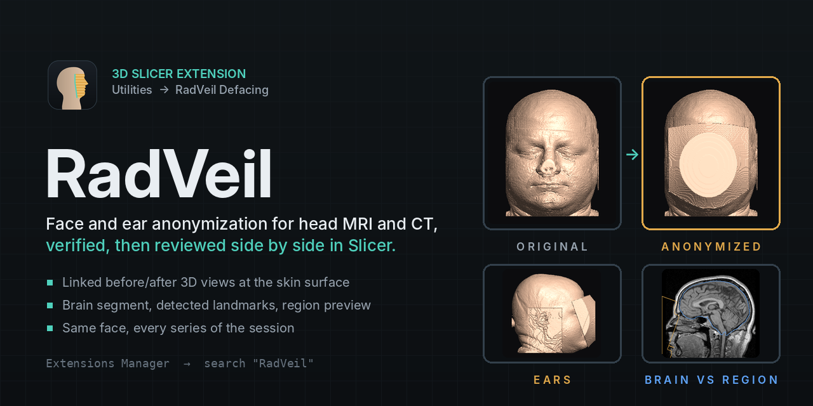
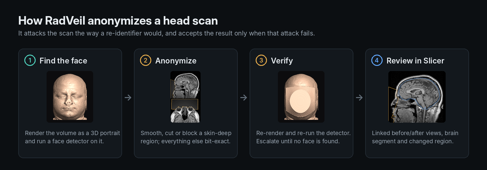

<p align="center">
  
</p>

<p align="center">
  <a href="https://github.com/rAum/SlicerRadVeil/actions/workflows/ci.yml"></a>
  <a href="LICENSE"></a>
  <a href="https://github.com/rAum/radveil"></a>
</p>

# SlicerRadVeil

3D Slicer extension for face and ear anonymization (defacing) of MRI and CT
head volumes with [RadVeil](https://github.com/rAum/radveil).

RadVeil renders the volume as a 3D portrait, finds the face with a built-in
face detector, anonymizes it, and accepts the result only when the detector
no longer finds a face. Voxels outside the anonymization region are copied
unchanged (bit-exact, same voxel type).



**In Slicer you get:**

- **One-click anonymization** of the face, the ears, or both: adaptive
  smoothing, blur, remove or opaque block, with a separate method for the ears.
- **Before/after review**: original and anonymized skin surfaces side by side
  in linked 3D views, with a skin-threshold slider to hunt for leftover detail.
- **Preview region**: outline what would be anonymized, and the face landmarks
  RadVeil found, before changing anything.
- **Brain segment**: SynthStrip brain (blue) next to the changed region (amber),
  so the clearance is visible, plus an optional hard brain guard.
- **Other series**: anonymize FLAIR, DWI and other series of the session with
  the face found on the T1, each re-checked with the face detector.
- **A plain-language verdict** (green, amber or red) and RadVeil's full JSON
  report for your study records.

> [!WARNING]
> **Early release (0.1), limited validation.** RadVeil has been tested on a
> small set of public scans only. It is a de-identification *aid*, not a
> medical device and not a complete de-identification process. It is
> provided as is, without warranty (see [Disclaimer](#disclaimer)).
> **Review every output before sharing data.**

## Install

**From the Extensions Manager** (once listed): *View → Extensions Manager →
search "RadVeil" → Install*, restart Slicer.

The first time you click **Anonymize** the module offers to install the
`radveil` Python package into Slicer's Python (`pip install "radveil>=0.1,<0.2"`).
Prebuilt wheels exist for Windows x86-64, macOS (Intel and Apple Silicon) and
Linux (x86-64 and ARM64); no compiler, ML framework or model download is needed.

**Offline computers:** download the matching wheel on another machine
(`pip download radveil --only-binary=:all: --python-version 3.12 --platform <tag>`,
or from the RadVeil GitHub release), then use **Install from wheel file...**
in the module.

Supported Slicer versions: 5.6 and later (Python ≥ 3.9; RadVeil wheels are abi3).

## Use

1. Load a head MRI or CT (any grayscale volume: NIfTI, NRRD, DICOM series, ...).
2. Open **Utilities → RadVeil Defacing**. The first time, a banner offers to
   install the RadVeil package (one click, needed once).
3. Choose what to anonymize (**Face**, **Face + ears**, **Ears only**) and the
   method (**Adaptive smoothing** is recommended).
4. Optional: click **Preview region**. The region RadVeil would change is
   outlined in amber (in 3D and in the slices) with the 68 face landmarks it
   found, and nothing is modified.
5. Optional: under **Other series**, tick more series of the same session.
   They must be aligned with the input (same scanner session, or registered).
6. Click **Anonymize**. Slicer stays responsive while it runs; *Cancel*
   discards the result.
7. Review. The module switches to a comparison layout: the **original and
   anonymized faces side by side in linked 3D views** (rotate one, both follow),
   rendered as the skin surface the face detector attacks, with the detected
   landmarks on the original. Move **Skin threshold** to look for detail
   another surface would reveal. The slice views show the anonymized volume
   with the **changed region** (amber) and, if you ticked *Add brain segment*,
   the **brain** (blue); the slice views' fade slider blends in the original.
   Click **Compare before / after** again to restore your previous layout.
8. The **Result** box gives a plain-language verdict (green, amber or red) with
   any findings, e.g. an ear outside the field of view or a series that is not
   aligned. **Save report...** writes RadVeil's full JSON report.

Outputs go next to the input in the Data module: a new **Anonymized volume**
(same voxel type and geometry; voxels outside the region are bit-identical)
and an **Anonymized region** segmentation of exactly the changed voxels.
Every run creates new nodes unless you pick existing ones, so anonymizing the
next scan never overwrites an earlier result. Output names and the report
deliberately do not reuse the input's name, which often contains the
patient's name.

If no plausible face is found (non-head data, an already defaced scan, a face
cut by the field of view) RadVeil **refuses** and nothing changes; the Result
box suggests what to try. *Advanced* has opt-ins for these cases (*Face cut by
the field of view*, *Noisy or dim scans*), for brain safety (*Never touch the
brain*, *Report brain contact*), a separate ear method, and verification
thoroughness.

The module always applies exactly the method you chose. If the face detector
still finds a face afterwards (a *Remove* cut can expose bone whose eye
sockets read as a face), the result is marked red and suggests what to try,
e.g. **Opaque block**. (RadVeil's own unattended default is to switch to an
opaque block by itself; from Python, `process(..., blockFallback=True)` does
that.)

**What is not anonymized:** RadVeil only changes voxels. Patient names in
node names, file names and DICOM tags are untouched; use DICOM anonymization
when you export.

Volumes under a linear transform are handled (the transform is taken into
account and kept). Non-linear transforms must be hardened first. 4D and
multi-component volumes are not supported.

### Python / batch use inside Slicer

```python
import RadVeil
logic = RadVeil.RadVeilLogic()
preview = logic.previewRegion(getNode("MRHead"), region="face+ears")   # changes nothing
result = logic.process(getNode("MRHead"), region="face+ears", mode="adaptive",
                       earMode="cut", brain_guard=True, brainSegment=True,
                       otherVolumes=[getNode("FLAIR")])
result.outputVolume, result.regionSegmentation, result.landmarks, result.otherSeries, result.report
```

For large cohorts outside Slicer use `radveil.deface_batch` directly.

## Development

```
RadVeil/                     scripted module
  RadVeil.py                 module, widget, logic, Slicer self-test
  RadVeilLib/conversion.py   Slicer <-> RadVeil arrays/geometry (pure numpy)
  RadVeilLib/backend.py      install / load the radveil package
  RadVeilLib/mock_radveil.py stand-in for radveil (development only)
tests/                       unit tests (no Slicer) + in-Slicer CI runner
tools/                       packaging check/staging, CI helpers, version range tool,
                             screenshots (in Slicer) and graphics (make_graphics.py)
docs/images/                 README graphics; radveil/ holds RadVeil's MRHead renders
.github/                     CI and release workflows, Slicer setup action
RadVeil.json                 entry for Slicer/ExtensionsIndex (tracks `release`)
```

- Try it without building: *Edit → Application Settings → Modules →
  Additional module paths* → add `.../SlicerRadVeil/RadVeil`, restart. Or,
  in Slicer's Python console, without a restart:
  `p = ".../SlicerRadVeil/tools/slicer_dev_setup.py"; exec(open(p).read(), {"__file__": p})`
- Self-test in Slicer: *Developer mode* on, then **Reload and Test** in the
  module (uses the mock backend; set `RADVEIL_SLICER_TEST_REAL=1` to also run
  the real package on the MRHead sample).
- Unit tests: `pip install numpy pytest && pytest tests/`.
- Screenshots: CI's *Real radveil* job on Linux uploads a `screenshots`
  artifact (real run on MRHead: `RadVeil.png`, `layout.png`, `panel.png`,
  `preview.png`). To make them yourself: `Slicer --additional-module-paths
  RadVeil --python-script tools/make_screenshots.py`, then
  `python tools/compose_screenshot.py Screenshots`.
- Graphics: `python tools/make_graphics.py` redraws the icon, the banner and
  the how-it-works figure.
- **Mock backend:** with Slicer's *Developer mode* on, the module shows a
  *Developer* section with *Use mock backend*; or start Slicer with
  `RADVEIL_SLICER_MOCK=1`. Regular users never see it. It mimics the RadVeil
  API (masks an anterior shell of the head) so the panel can be developed and
  self-tested offline, without installing radveil. It does **not** anonymize.

## Guarantees and limits

- Voxels outside the anonymized region are bit-identical to the input, with
  the same voxel type and geometry.
- Only voxels change. Node names, file names, NIfTI/DICOM headers and other
  metadata are **not** scrubbed; that is the job of your de-identification
  pipeline (e.g. DICOM anonymization on export).
- The face detector check shows resistance to that class of detector, not
  to every conceivable re-identification attack. The *Anonymized region*
  segmentation records exactly which voxels changed, for independent audit.
- When RadVeil refuses (no plausible face), nothing is changed: treat it as
  an item for human review, never as a processed scan.
- 3D volumes only. CT support is validated on synthetic phantoms only.

See RadVeil's [legal and data-governance notes](https://github.com/rAum/radveil/blob/main/docs/legal.md)
for licensing, privacy-regulation context and the optional dlib detector.

## Releases and distribution

Releases are automated: pushing a `vX.Y.Z` tag on `main` runs the full test
suite, including the self-test inside real Slicer (Stable and Preview, Linux)
and the real radveil package on MRHead, publishes
a GitHub release with a module zip, and moves the `release` branch that the
Slicer Extensions Index builds from. The extension then appears in the
Extensions Manager the next day. See [RELEASING.md](RELEASING.md) for the
pipeline, one-time setup and the Extensions Index submission.

## License

Copyright 2026 Piotr Gródek and the SlicerRadVeil contributors. Licensed
under the [Apache License, Version 2.0](LICENSE); see also [NOTICE](NOTICE).

The extension installs the separately distributed `radveil` package, which
keeps its own licenses: it embeds the MediaPipe BlazeFace / Face Mesh models
(Apache-2.0, Google LLC) and the SynthStrip weights (MIT; please cite Hoopes
et al., NeuroImage 260 (2022) 119474 when you publish results). The head
images in the graphics are RadVeil's renders of 3D Slicer's public MRHead
sample, which its donor gave to the 3D Slicer project to be used without
restrictions. Security issues: see [SECURITY.md](SECURITY.md).

## Disclaimer

RadVeil and this extension are a personal, open-source project developed in
the author's spare time, on personal equipment. They are not affiliated with,
sponsored or endorsed by, and do not represent any current or former employer
of the author; the views and code here are the author's own. Names of
third-party projects (3D Slicer, MediaPipe, SynthStrip, dlib) are used only
to identify the software and data the extension works with and do not imply
endorsement by their owners.

Generative AI tools were used in developing this extension, including code
and documentation.

The software is provided "as is", without warranty of any kind (see the
license). To the maximum extent permitted by applicable law, the authors
accept no liability for any damages or losses arising from its use. It is
not a medical device, is not intended for diagnosis or treatment, and does
not by itself make data compliant with any privacy regulation (e.g. HIPAA or
GDPR). You are responsible for validating it for your use case.
